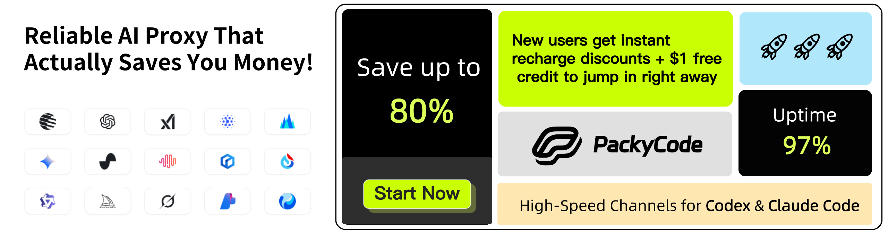
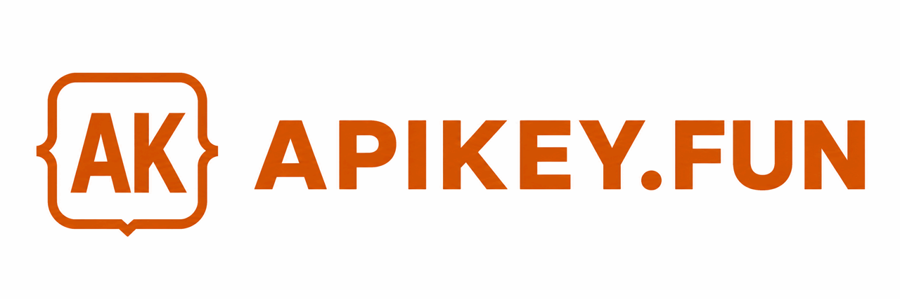
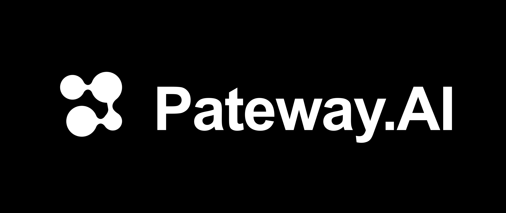

# CLIProxyAPI Plus

English | [Chinese](README_CN.md)

This is the Plus version of [CLIProxyAPI](https://github.com/router-for-me/CLIProxyAPI), adding support for third-party providers on top of the mainline project.

> [!NOTE]
> Upstream reference (for baseline behavior/docs): https://github.com/luispater/CLIProxyAPI/blob/main/README.md

---

> [!IMPORTANT]
> ## This is a fork (read me first)
> This repository is a fork/derivative build of CLIProxyAPI.
>
> **Motivation:** make it easy to use your *existing* AI subscriptions (Claude Code, Codex, Gemini, Copilot, etc.) from any OpenAI-compatible client/SDK and from multiple coding CLIs — locally or hosted — without rewriting tooling.
>
> **What’s different from upstream (and why):**
>
> - **More provider adapters & auth flows (Copilot, Grok, etc.)** — so you can route requests through the subscription/provider you already pay for, using a consistent OpenAI-compatible API surface.
> - **Cursor Composer 2.5 (API key + SDK sidecar)** — route `composer-2.5` and related models through your Cursor subscription via `CURSOR_API_KEY` / `cursor-api-key` YAML. By default ("Cursor Composer Client-Tools"), the patched `@cursor/sdk` agent bridge (`sidecars/cursor-bridge/cursor-agent-bridge.mjs`) owns all Cursor I/O and every tool executes on the client through CLIProxy. Railway starts the bridge on `CURSOR_AGENT_BRIDGE_PORT` (default `9798`) automatically when `CURSOR_API_KEY` is set; set `CURSOR_DIRECT=1` only to opt into the gated legacy direct path.
> - **Chutes provider support (API key + dynamic model discovery)** — optionally expose Chutes-hosted models via OpenAI-compatible endpoints using `CHUTES_API_KEY` / `CHUTES_BASE_URL`. Supports configurable retry logic with `CHUTES_MAX_RETRIES` (default: 4) and `CHUTES_RETRY_BACKOFF` (default: `5,15,30,60` seconds).
> - **Managed provider support (API key + dynamic model discovery)** — define externally hosted providers with Anthropic, OpenAI Chat Completions, and/or OpenAI Responses upstream transports; expose protocol-pinned aliases; persist route health; and set per-provider transport/redaction policy.
> - **Passthru model routing (env + YAML)** — declare arbitrary model IDs (e.g. `glm-4.7`) that are forwarded to external upstream APIs (OpenAI-compatible / Anthropic / Responses), with per-route API keys/headers; ideal for hosted deployments (Railway) via `PASSTHRU_MODELS_JSON`.
> - **Railway-first deployment path** (`scripts/railway_start.sh`, `docs/RAILWAY_GUIDE.md`) — to make it dead simple to spin up a personal, always-on CLIProxyAPI instance you can call from anywhere.
>   - Log in locally (interactive browser/device flows), then package credentials into `AUTH_BUNDLE` via `scripts/auth_bundle.sh` and restore them in a remote environment.
> - **Hosted-friendly credential transfer** (`AUTH_BUNDLE`/`AUTH_ZIP_URL`) — avoids having to manually copy lots of files/secrets around when deploying.
> - **Compatibility emphasis (including Responses-style clients)** — so tools expecting OpenAI-compatible endpoints “just work” with minimal configuration.
> - **One config, many tools** — point Claude Code / Codex CLI / Gemini-compatible clients / IDE extensions at one base URL and let the proxy handle provider routing and account management.
>
> If you only want the upstream behavior/features, compare against the original upstream repository and docs.

> Recommended companion tools / related forks:
>
> - **Patch-22** (recommended): a tiny `apply_patch` safety net binary/script for when a model tries to run `apply_patch` as a shell command: [`github.com/jeffnash/patch-22`](https://github.com/jeffnash/patch-22).
> - **Letta Code (jeffnash fork)**: [`github.com/jeffnash/letta-code`](https://github.com/jeffnash/letta-code) is wired up to route main model calls through a hosted `jeffnash/CLIProxyAPI` instance.
> - **Letta (jeffnash fork)**: [`github.com/jeffnash/letta`](https://github.com/jeffnash/letta) includes scripts to deploy the Letta server to Railway and pairs well with this proxy.

---

All third-party provider support is maintained by community contributors; CLIProxyAPI does not provide technical support. Please contact the corresponding community maintainer if you need assistance.

A proxy server that provides OpenAI/Gemini/Claude/Codex/Grok compatible API interfaces for CLI.

It now also supports OpenAI Codex (GPT models) and Claude Code via OAuth.

The Plus release stays in lockstep with the mainline features.

## Differences from the Mainline

[](https://z.ai/subscribe?ic=8JVLJQFSKB)

This project is sponsored by Z.ai, supporting us with their GLM CODING PLAN.

GLM CODING PLAN is a subscription service designed for AI coding, starting at just $3/month. It provides access to their flagship GLM-4.7 model across 10+ popular AI coding tools (Claude Code, Cline, Roo Code, etc.), offering developers top-tier, fast, and stable coding experiences.

Get 10% OFF GLM CODING PLAN：https://z.ai/subscribe?ic=8JVLJQFSKB

---

<table>
<tbody>
<tr>
<td width="180"><a href="https://www.packyapi.com/register?aff=cliproxyapi"></a></td>
<td>Thanks to PackyCode for sponsoring this project! PackyCode is a reliable and efficient API relay service provider, offering relay services for Claude Code, Codex, Gemini, and more. PackyCode provides special discounts for our software users: register using <a href="https://www.packyapi.com/register?aff=cliproxyapi">this link</a> and enter the "cliproxyapi" promo code during recharge to get 10% off.</td>
</tr>
<tr>
<td width="180"><a href="https://cubence.com/signup?code=CLIPROXYAPI&source=cpa"></a></td>
<td>Thanks to Cubence for sponsoring this project! Cubence is a reliable and efficient API relay service provider, offering relay services for Claude Code, Codex, Gemini, and more. Cubence provides special discounts for our software users: register using <a href="https://cubence.com/signup?code=CLIPROXYAPI&source=cpa">this link</a> and enter the "CLIPROXYAPI" promo code during recharge to get 10% off.</td>
</tr>
</tbody>
</table>

## Fork-Focused Quickstart

This fork is primarily optimized for:

- Using **OAuth/subscription logins** (Codex / Claude Code / Gemini / Copilot / etc.) behind an OpenAI-compatible base URL
- **Hosting your own personal instance** (especially on Railway) so you can call it from anywhere

Key docs:

- End-user Railway deployment: `docs/RAILWAY_GUIDE.md`
- Railway Copilot Electron shim: `docs/RAILWAY_ELECTRON_SHIM.md`
- Railway scripts reference: `scripts/README_RAILWAY.md`
- SDK usage (embed the proxy in Go): `docs/sdk-usage.md`
- SDK advanced: `docs/sdk-advanced.md`
- SDK access/auth: `docs/sdk-access.md`
- Credential watching: `docs/sdk-watcher.md`

Provider & config matrix (fork-specific):

| Topic | Where | Notes |
| :--- | :--- | :--- |
| Provider login commands (Gemini / Claude / Codex / Copilot / Grok / Qwen / iFlow / Antigravity / Vertex) | `docs/RAILWAY_GUIDE.md` | See the “Local Authentication” table for exact `--*-login` flags. |
| Grok support | `docs/RAILWAY_GUIDE.md` | Uses `--grok-login` (SSO cookies flow). |
| Copilot support | `docs/RAILWAY_GUIDE.md` | Uses `--copilot-login` (device code flow). |
| Cursor Composer support | `internal/config/config.go` / `scripts/README_RAILWAY.md` | Env: `CURSOR_API_KEY` (also `cursor-api-key` in YAML). Sidecar: `sidecars/cursor-bridge/cursor-agent-bridge.mjs` (patched `@cursor/sdk` agent bridge, [Railpack Node 22](https://railpack.com/languages/node)) on `CURSOR_AGENT_BRIDGE_PORT` (default `9798`). Bridge tuning: `CURSOR_AGENT_BRIDGE_URL`, `CURSOR_AGENT_STATE_ROOT`; `CURSOR_DIRECT=1` opts into the gated legacy direct path. Railway: set `RAILPACK_PACKAGES=go@1.26 node@22`. Models: `composer-2.5`, `composer-2.5-fast`, etc. |
| Claude Code → Cursor via proxy | `scripts/claude-code-cursor.sh` | `source scripts/claude-code-cursor.sh on` points Claude Code at CLIProxyAPI; local auth uses `ignored` (must match `api-keys` in config). |
| Railway env vars (auth transfer) | `scripts/README_RAILWAY.md` | `AUTH_BUNDLE` or `AUTH_ZIP_URL`, plus `API_KEY_1`, optional `AUTH_DIR_NAME`, `FORCE_BUILD`, optional `CURSOR_API_KEY`. |
| Copilot initiator behavior | `internal/runtime/executor/copilot_headers.go` | Default is `X-Initiator: agent` for Copilot requests. Trusted internal callers can override via request header `force-copilot-initiator: user` (used by Copilot Hot Takes). |
| Copilot config keys (YAML) | `internal/config/config.go` | Look under `CopilotKey` config + related fields for the authoritative schema (initiator flags + header profile selection). |
| Copilot header behavior | `internal/runtime/executor/copilot_headers.go` | Implementation for request header shaping / agent-call behavior + optional header profile emulation. |
| Copilot model registry | `internal/registry/copilot_models.go` | How Copilot models are enumerated/aliased. |
| Force Copilot routing | `sdk/api/handlers/handlers.go` / `sdk/cliproxy/auth/conductor.go` | Use `copilot-<model>` to explicitly route to Copilot even if the model isn't registered; bypasses client model support filtering. |
| Force Codex routing | `sdk/api/handlers/handlers.go` / `sdk/cliproxy/auth/conductor.go` | Use `codex-<model>` to explicitly route to Codex; sets `forced_provider=true` to bypass client model support filtering. |
| Force Kimi routing | `sdk/api/handlers/handlers.go` / `sdk/cliproxy/auth/conductor.go` | Use `kimi-<model>` to explicitly route to Kimi; sets `forced_provider=true` to bypass client model support filtering. |
| Force iFlow routing | `sdk/api/handlers/handlers.go` / `sdk/cliproxy/auth/conductor.go` | Use `iflow-<model>` to explicitly route to iFlow; sets `forced_provider=true` to bypass client model support filtering. |
| Copilot Hot Takes | `internal/cmd/copilot_hot_takes.go` / `docs/RAILWAY_GUIDE.md` | Optional background job controlled by `COPILOT_HOT_TAKES_INTERVAL_MINS` and `COPILOT_HOT_TAKES_MODEL`. |
| Grok config schema | `internal/config/config.go` | `GrokKey` and `GrokConfig` sections define available knobs. |
| Chutes support (env + YAML) | `internal/config/config.go` / `docs/RAILWAY_GUIDE.md` | Env vars: `CHUTES_API_KEY`, `CHUTES_BASE_URL`, `CHUTES_MODELS`, `CHUTES_MODELS_EXCLUDE`, `CHUTES_PRIORITY`, `CHUTES_TEE_PREFERENCE`, `CHUTES_PROXY_URL`, `CHUTES_MAX_RETRIES`. YAML: `chutes` section. |
| Force Chutes routing | `sdk/api/handlers/handlers.go` / `sdk/cliproxy/auth/conductor.go` | Use `chutes-<model>` to explicitly route to Chutes; sets `forced_provider=true` to bypass client model support filtering. |
| Chutes model aliasing + fallbacks | `internal/registry/chutes_models.go` | Generates `chutes-` aliases for explicit routing + contains conservative fallback models. |
| Chutes executor | `internal/runtime/executor/chutes_executor.go` | Implements OpenAI-compatible chat completions + streams, model fetch/cache, and token counting. |
| Chutes priority filtering | `sdk/cliproxy/service.go` / `sdk/cliproxy/chutes_priority_hook.go` | `CHUTES_PRIORITY=fallback` hides non-prefixed Chutes IDs when another provider has the same model ID; `chutes-` aliases remain routable. |
| Managed providers (env + YAML) | `internal/config/config.go` / `docs/RAILWAY_GUIDE.md` | Configure `managed-providers` in YAML or `MANAGED_PROVIDERS_JSON` in env. Each provider declares `name`, `prefix`, API key source, endpoint URLs/paths, model discovery, fallback models, priority, retry settings, route-health settings, and optional redaction policy. |
| Force managed-provider routing | `sdk/api/handlers/handlers.go` / `sdk/cliproxy/auth/conductor.go` | Use the configured prefix, such as `example-<model>`, to explicitly route to that provider; protocol-pinned forms include `anthropic-example-<model>`, `openai-example-<model>`, `openai-responses-example-<model>`, and `openai-completions-example-<model>`. |
| Managed-provider model aliasing + fallbacks | `internal/registry/managed_provider_models.go` | Generates configured-prefix aliases plus transport aliases for explicit routing and can publish configured fallback models when live discovery is unavailable. |
| Managed-provider executor + health routing | `internal/runtime/executor/managed_provider_executor.go` / `internal/runtime/executor/managed_provider_health.go` | Translates between client protocol and selected upstream protocol, falls back across transports before a response stream is returned, persists transport health, and probes alternate transports for auto-routing. |
| Provider-aware Secret DLP | `internal/secretdlp` / `sdk/api/handlers/handlers.go` | Redacts secrets after provider selection and before upstream execution, restores placeholders on the way back when `SECRET_DLP_MODE=restore`, supports encrypted file-backed mappings, and supports global, per-provider, and per-auth opt-in/out policy. |
| OAuth excluded models | `internal/config/config.go` | `oauth-excluded-models` config lets you disable models per provider. |
| OpenAI-compat upstreams | `internal/config/config.go` | `openai-compatibility` for routing to other OpenAI-compatible providers. |
| Routing behavior | `internal/config/config.go` | `routing` config controls credential selection/failover. |

### Copilot initiator (fork default)

This fork defaults Copilot requests to `X-Initiator: agent`.

Trusted internal callers can override the initiator with the request header:

- `force-copilot-initiator: user|agent`

This is used for opt-in background jobs (see Copilot Hot Takes in `docs/RAILWAY_GUIDE.md`).

### Chutes config (quick explainer)

Chutes is an optional OpenAI-compatible upstream. You can route to it either explicitly (recommended) or by exposing non-prefixed IDs.

- Explicit routing: set `model: "chutes-<model>"` (works as long as Chutes is configured).
- Env vars:
  - `CHUTES_API_KEY` (required), `CHUTES_BASE_URL` (optional)
  - `CHUTES_MODELS` / `CHUTES_MODELS_EXCLUDE` (optional allow/block lists)
  - `CHUTES_PRIORITY` (`fallback` default hides non-prefixed IDs when another provider offers the same ID; `primary` exposes them)
  - `CHUTES_TEE_PREFERENCE` (`prefer` default), `CHUTES_PROXY_URL` (optional)
  - `CHUTES_MAX_RETRIES` (default `4`; set `0` to disable) — retries intermittent 429s

### Managed providers (quick explainer)

Managed providers are optional externally hosted model providers with Claude/Anthropic-compatible and/or OpenAI-compatible endpoints. They can be configured in YAML under `managed-providers` or through `MANAGED_PROVIDERS_JSON` for hosted environments.

- Explicit routing: set `model: "example-<model>"` when the provider prefix is `example-`.
- Protocol aliases:
  - `anthropic-example-<model>` pins Anthropic/messages first, then falls back to OpenAI Responses, then OpenAI Chat Completions.
  - `openai-responses-example-<model>` pins OpenAI Responses first, then falls back to Chat Completions, then Anthropic/messages.
  - `openai-completions-example-<model>` pins OpenAI Chat Completions first, then falls back to Responses, then Anthropic/messages.
  - `openai-example-<model>` uses the best OpenAI transport, Responses or Chat Completions, then falls back to Anthropic/messages.
  - `example-<model>` or unprefixed published IDs use the best available transport across all configured transports.
- Endpoint independence: clients may call OpenAI Chat Completions, OpenAI Responses, or Anthropic Messages endpoints with any managed-provider alias. CLIProxyAPI translates the request into the selected upstream transport and translates the response/stream back to the client-requested protocol.
- Auto routing prefers the client-native format on ties, so Anthropic callers prefer Anthropic, Responses callers prefer Responses, and Chat Completions callers prefer Chat Completions when health scores are otherwise equal.
- Model discovery: enabled by default via the provider's `/models` endpoint; use `fallback-models` when discovery is unavailable or incomplete.
- Priority: `fallback` hides non-prefixed IDs when another provider registers the same model ID; prefixed aliases remain routable.
- Route health:
  - `route-health.enabled` is on by default and stores provider/model/transport health in `managed_provider_health.json` under `auth-dir`, or under `RAILWAY_VOLUME_MOUNT_PATH` when present.
  - Health state records success EWMA, latency EWMA, timeout counts, cooldowns, unsupported endpoint TTLs, probe timestamps, and safe error summaries.
  - Cooldowns are only set for availability signals: network failures, timeouts, HTTP 408, retryable 429/5xx, and explicit unsupported/not-implemented endpoint responses. Request-specific client errors such as 400/401/403 are recorded but do not poison transport health.
  - Protocol-pinned aliases are only demoted away from their primary transport when that transport is explicitly unsupported. Auto routes can demote cooled-down transports.
  - Background probes are per-provider limited by `route-health.max-concurrent-probes`, respect `route-health.probe-interval`, and quickly sample alternate transports for latency/reliability.
  - `route-health.first-event-timeout` is off by default. When set, streaming requests can fail over mid-bootstrap if the upstream accepts the connection but emits no meaningful SSE event before the timeout and another fallback transport remains. After CLIProxyAPI returns a downstream stream, later stream errors are emitted to the client rather than retried.
- Non-2xx managed-provider logs and health files store status, type/code, and tightly allowlisted messages rather than raw upstream bodies, so prompt/tool content echoed by providers is not persisted as health metadata.
- Hosted env format:
  ```json
  [
    {
      "name": "example-provider",
      "prefix": "example-",
      "api-key-env": "EXAMPLE_PROVIDER_API_KEY",
      "base-url": "https://provider.example/v1",
      "claude-messages-path": "/messages",
      "openai-chat-path": "/chat/completions",
      "openai-responses-path": "/responses",
      "transport-mode": "auto",
      "default-transport": "claude",
      "route-health": {
        "enabled": true,
        "probe-enabled": true,
        "probe-interval": "15m",
        "probe-timeout": "8s",
        "first-event-timeout": "",
        "cooldown": "5m",
        "unsupported-ttl": "6h",
        "max-concurrent-probes": 2
      },
      "priority": "fallback",
      "fallback-models": ["model-a", "model-b"]
    }
  ]
  ```

### Secret DLP (quick explainer)

Secret DLP can redact detected secrets after CLIProxyAPI has selected a provider and auth credential, before the payload is sent upstream. In restore mode, placeholders are restored in upstream responses before they are returned to the client.

- Enable with `SECRET_DLP_ENABLED=true`.
- Modes:
  - `SECRET_DLP_MODE=restore` redacts upstream payloads and restores placeholders in responses.
  - `SECRET_DLP_MODE=redact` sends placeholders upstream and leaves placeholders in responses.
  - `SECRET_DLP_MODE=block` rejects requests with findings.
- Placeholders use the `__CPA_DLP_v1_...` shape. Detection/redaction events do not log raw secret values.
- Storage:
  - `SECRET_DLP_STORE=memory` keeps placeholder mappings in process memory.
  - `SECRET_DLP_STORE=file` persists encrypted mappings; set `SECRET_DLP_MASTER_KEY`, and optionally `SECRET_DLP_FILE_DIR`. If `SECRET_DLP_FILE_DIR` is empty on Railway, it defaults to `$RAILWAY_VOLUME_MOUNT_PATH/secret_dlp`.
  - `SECRET_DLP_TTL_SECONDS` controls mapping lifetime; `SECRET_DLP_DRAIN_SECONDS` controls shutdown drain time.
  - `SECRET_DLP_STORE_FAIL_CLOSED=true` makes store failures reject rather than degrade.
- Scanner controls:
  - `SECRET_DLP_SCANNER=betterleaks` is the default scanner.
  - `SECRET_DLP_MAX_FINDINGS`, `SECRET_DLP_MIN_VALUE_LENGTH`, `SECRET_DLP_REDACT_THRESHOLD`, and `SECRET_DLP_BETTERLEAKS_CONFIDENCE` tune detection.
  - `SECRET_DLP_HIGH_ENTROPY=true` opts into generic high-entropy matching; explicit credential shapes are detected without requiring this.
  - Built-in explicit detectors cover OpenAI-style `sk-` keys, known provider/API token prefixes and webhook URLs, bearer/basic auth, JWTs, DSNs with user info, AWS/Azure credentials, PEM/PGP/PuTTY/age private keys, Solana/ed25519/EVM keys, BIP39 mnemonics with checksum validation, GCP service-account JSON, and Ethereum keystore JSON.
- Payload coverage is route-aware for `/v1/chat/completions`, `/v1/messages`, `/v1/responses`, and `/backend-api/codex/responses`, including system/instruction text, message content, tool arguments, and tool results.
- Policy controls:
  - `SECRET_DLP_DEFAULT_PROVIDER_POLICY=enabled|disabled` sets the global provider default.
  - `SECRET_DLP_PROVIDER_OVERRIDES=example-provider=disabled,other-provider=enabled` overrides specific providers.
  - Each managed provider can set `secret-redaction: enabled|disabled|inherit`.
  - Selected auth records can carry `secret_redaction`; auth-level policy takes precedence over provider overrides and global defaults.
- Failure controls:
  - `SECRET_DLP_FAIL_CLOSED=true` rejects requests when scanner/redaction fails.
  - `SECRET_DLP_LOG_EVENTS=true` logs redaction lifecycle events without logging the raw secret.

If you want the baseline upstream documentation/behavior, start here: https://github.com/luispater/CLIProxyAPI/blob/main/README.md

If you want more details (and exact env vars), see `docs/RAILWAY_GUIDE.md` and `scripts/README_RAILWAY.md`.

---

> Note: this fork’s docs intentionally focus on fork-specific behavior; the upstream README is the best reference for the baseline project.

---


Hosted instance goals:

- Log in locally once, then transfer credentials via `scripts/auth_bundle.sh` (`AUTH_BUNDLE`) to your host.
- Point your clients/tools at your hosted base URL and keep using the same API key.

## Capabilities (Fork)

- OpenAI-compatible API endpoints for chat + tools (plus provider routing)
- OAuth/cookie login flows for multiple providers and multi-account load balancing
- Streaming + non-streaming responses, multimodal inputs (where supported)
- Compatibility targets: OpenAI-compatible clients/SDKs (including Responses-style clients) + coding CLIs

## Getting Started

CLIProxyAPI Guides: [https://help.router-for.me/](https://help.router-for.me/)

## Management API

see [MANAGEMENT_API.md](https://help.router-for.me/management/api)

## Who is with us?

Those projects are based on CLIProxyAPI:

### [vibeproxy](https://github.com/automazeio/vibeproxy)

Native macOS menu bar app to use your Claude Code & ChatGPT subscriptions with AI coding tools - no API keys needed

### [Subtitle Translator](https://github.com/VjayC/SRT-Subtitle-Translator-Validator)

Browser-based tool to translate SRT subtitles using your Gemini subscription via CLIProxyAPI with automatic validation/error correction - no API keys needed

- Added GitHub Copilot support (OAuth login), provided by [em4go](https://github.com/em4go/CLIProxyAPI/tree/feature/github-copilot-auth)
- Added Kiro (AWS CodeWhisperer) support (OAuth login), provided by [fuko2935](https://github.com/fuko2935/CLIProxyAPI/tree/feature/kiro-integration), [Ravens2121](https://github.com/Ravens2121/CLIProxyAPIPlus/)

### [CCS (Claude Code Switch)](https://github.com/kaitranntt/ccs)

CLI wrapper for instant switching between multiple Claude accounts and alternative models (Gemini, Codex, Antigravity) via CLIProxyAPI OAuth - no API keys needed

### [ProxyPal](https://github.com/heyhuynhgiabuu/proxypal)

Native macOS GUI for managing CLIProxyAPI: configure providers, model mappings, and endpoints via OAuth - no API keys needed.

> [!NOTE]
> If you developed a project based on CLIProxyAPI, please open a PR to add it to this list.
# CLI Proxy API

English | [中文](README_CN.md) | [日本語](README_JA.md)

If you want to use CLIProxyAPI on your desktop, we recommend our [EasyCLIProxyAPI](https://github.com/router-for-me/EasyCLIProxyAPI) desktop client. It provides a graphical configuration UI, automatic updates, system tray integration, and one-click start/stop for the CLIProxyAPI service.

CLIProxyAPI is a proxy server that provides OpenAI/Gemini/Claude/Codex/Grok compatible API interfaces for CLI.

You can access the following providers locally and with multiple CLI accounts through any OpenAI (including Responses), Gemini (including Interactions), or Claude-compatible client or SDK.

<table>
<tbody>
    <tr>
        <th align="center" width="100">Provider</th>
        <th align="center">Description</th>
    </tr>
    <tr>
        <td align="center"><a href="https://www.kimi.com/code/?aff=cliproxyapi"></a></td>
        <td>Kimi series models (Kimi K3, K2.8 Preview, etc.). <a href="https://platform.kimi.ai/docs/guide/kimi-k3-quickstart">Kimi K3</a> is Moonshot AI’s most capable model and the world’s first open 3T-class model. With 2.8 trillion parameters, native vision, and a 1-million-token context window, K3 is built for long-horizon coding, knowledge work, and reasoning. CLIProxyAPI supports Kimi through OAuth or compatible API interfaces. Try a <strong>Kimi Code plan</strong> (<a href="https://www.kimi.com/code?aff=cliproxyapi">中文站</a> | <a href="https://www.kimi.ai/code?aff=cliproxyapi">Global</a>), or get an <strong>API key</strong> from the Kimi Open Platform (<a href="https://platform.kimi.com?track_id=track-f15622e7182046baa22ca35e006e13a7&aff=cliproxyapi">中文站</a> | <a href="https://platform.kimi.ai?track_id=track-8a28e4b291d84f62af2fccc3e7a21cb3&aff=cliproxyapi">Global</a>). Thanks to Kimi for supporting CLIProxyAPI and the open-source community!</td>
    </tr>
    <tr>
        <td align="center"><a href="https://developers.openai.com/api/docs/models"></a></td>
        <td>OpenAI GPT-6 models (GPT-6 Astra, GPT-6.1 Sol, GPT-6 Luna), including access through Codex OAuth. Astra is the flagship for complex reasoning and coding, Sol balances capability and cost, and Luna handles focused, high-volume work.</td>
    </tr>
    <tr>
        <td align="center"><a href="https://www.anthropic.com/claude/fable"></a></td>
        <td>Anthropic Claude models (Claude Fable 5.1, Claude Opus 5.5, Claude Sonnet 5.5, Claude Haiku 5.5). Fable 5.1 is built for ambitious, long-running coding and knowledge work; Opus 5.5 brings strong agentic coding at a lower cost.</td>
    </tr>
    <tr>
        <td align="center"><a href="https://antigravity.google/"></a></td>
        <td>Google Gemini models include Gemini 4 Argon and Gemini 3.8 Flash. CLIProxyAPI supports Gemini API, AI Studio, Vertex AI, Gemini CLI, and Antigravity accounts; model availability varies by channel. Gemini 3.8 Flash is Google's latest Flash model for long-horizon software engineering and agentic workflows. Antigravity's <a href="https://antigravity.google/docs/models/">official model availability</a> lists Claude Sonnet 5.5 (thinking) and Claude Opus 5.5 (thinking) for Google AI Pro (non-trial), Google AI Ultra, and Enterprise.</td>
    </tr>
    <tr>
        <td align="center"><a href="https://docs.x.ai/developers/grok-4-7"></a></td>
        <td>xAI Grok models (Grok 4.7, Grok 4.7 Build Fast, etc.). Grok 4.7 is SpaceXAI's latest model for coding, agentic tasks, and knowledge work.</td>
    </tr>
    <tr>
        <td align="center"><a href="https://dev.meta.ai/docs/overview"></a></td>
        <td>Meta Muse models (Muse Wonder Full, Muse Wonder, Muse Spark 1.3, etc.). CLIProxyAPI supports Muse Code accounts through Meta login and Meta Model API keys, with Muse Spark 1.3 for coding and agentic workflows. Meta has announced Muse Wonder for Meta Model API and Muse Code, and Muse Wonder Full for Muse Code subscribers.</td>
    </tr>
    <tr>
        <td align="center"><a href="https://devin.ai/cli">Devin</a></td>
        <td>Devin models (SWE-2, GPT-6 Astra, Claude Fable 5.1, etc.). Connect a Devin account with <code>--devin-login</code> to route the models available to that account.</td>
    </tr>
    <tr>
        <td align="center">CodeBuddy</td>
        <td>Tencent CodeBuddy / WorkBuddy HY4 series models via native account login. Each account serves its own HY4 catalog snapshot across the cn, global and workbuddy-global profiles. See <a href="./docs/codebuddy.md">docs/codebuddy.md</a>.</td>
    </tr>
</tbody>
</table>


## Sponsor

[](https://www.packyapi.com/register?aff=cliproxyapi)

Thanks to PackyCode for sponsoring this project!

PackyCode is a reliable and efficient API relay service provider, offering relay services for Claude Code, Codex, Gemini, and more.

PackyCode provides special discounts for our software users: register using <a href="https://www.packyapi.com/register?aff=cliproxyapi">this link</a> and enter the "cliproxyapi" promo code during recharge to get 10% off.

---

<table>
<tbody>
<tr>
<td width="180"><a href="https://www.aicodemirror.ai/register?invitecode=TJNAIF"></a></td>
<td>Thanks to AICodeMirror for sponsoring this project! AICodeMirror provides official high-stability relay services for Claude Code / Codex / Gemini, with enterprise-grade concurrency, fast invoicing, and 24/7 dedicated technical support. Claude Code / Codex / Gemini official channels at 38% / 2% / 9% of original price, with extra discounts on top-ups! AICodeMirror offers special benefits for CLIProxyAPI users: register via <a href="https://www.aicodemirror.ai/register?invitecode=TJNAIF">this link</a> to enjoy 20% off your first top-up, and enterprise customers can get up to 25% off!</td>
</tr>
<tr>
<td width="180"><a href="https://shop.bmoplus.com/?utm_source=github"></a></td>
<td>Huge thanks to BmoPlus for sponsoring this project! BmoPlus is a highly reliable AI account provider built strictly for heavy AI users and developers. They offer rock-solid, ready-to-use accounts and official top-up services for ChatGPT Plus / ChatGPT Pro (Full Warranty) / Claude Pro / Super Grok / Gemini Pro. By registering and ordering through <a href="https://shop.bmoplus.com/?utm_source=github">BmoPlus - Premium AI Accounts & Top-ups</a>, users can unlock the mind-blowing rate of <b>10% of the official GPT subscription price (90% OFF)</b>!</td>
</tr>
<tr>
<td width="180"><a href="https://visioncoder.cn/"></a></td>
<td>Thanks to VisionCoder for supporting this project. <a href="https://visioncoder.cn/">VisionCoder Developer Platform</a> is a reliable and efficient API relay service provider, offering access to mainstream AI models such as Claude Code, Codex, and Gemini. It helps developers and teams integrate AI capabilities more easily and improve productivity. Additionally, VisionCoder now offers retail channels for <b>Claude Max 200 and GPT Pro 200 premium accounts</b>, providing users with instant access to top-tier AI computing power and features.</td>
</tr>
<tr>
<td width="180"><a href="https://apikey.fan/register?aff=CLIProxyAPI"></a></td>
<td>Thanks to APIKEY.FUN for sponsoring this project! APIKEY.FUN is a professional enterprise-grade AI relay platform dedicated to providing stable, efficient, and low-cost AI model API access for enterprises and individual developers. The platform supports popular mainstream models such as Claude, OpenAI, and Gemini, with prices as low as 7% of the official price. Register through this project's <a href="https://apikey.fan/register?aff=CLIProxyAPI">exclusive link</a> to enjoy a special <b>permanent 5% top-up discount</b>.</td>
</tr>
<tr>
<td width="180"><a href="https://api.fenno.ai/s/Cvf0"></a></td>
<td>FennoAI is a stable and efficient API relay service provider, currently focused on Codex relay services. It is compatible with OpenAI and Anthropic protocols and can flexibly integrate with mainstream coding tools such as Codex, Claude Code, and OpenCode. It can reliably support enterprise-grade demand of hundreds of billions of tokens per day, with B2B settlement and invoicing available for both domestic and overseas entities. FennoAI offers an exclusive benefit for CLIProxyAPI users: purchase a subscription through the <a href="https://api.fenno.ai/s/Cvf0">exclusive link</a> and receive $50 worth of Coding Plan credits for just $1.99. Referral rewards are also available: earn up to 20% commission when invited friends make a purchase. The more friends you invite, the greater the rewards.</td>
</tr>
<tr>
<td width="180"><a href="https://s.qiniu.com/7zUJri"></a></td>
<td>Thanks to <a href="https://s.qiniu.com/7zUJri">Qiniu Cloud AI</a> for sponsoring this project! Qiniu Cloud AI is an enterprise-grade large-model MaaS platform under Qiniu Cloud (02567.HK). It provides one-stop access to 150+ mainstream global models, is compatible with protocols from major global model providers, and covers full-modal processing capabilities for text, image, audio, video, and files. It serves more than 1.69 million enterprise and developer users. Exclusive benefits: enterprise users can claim 12 million free tokens, and invite friends to earn up to tens of billions of tokens.</td>
</tr>
<tr>
<td width="180"><a href="https://cubence.com/signup?code=CLIPROXYAPI&source=cpa"></a></td>
<td>Thanks to Cubence for sponsoring this project! Cubence is a reliable and efficient API relay service provider, offering relay services for Claude Code, Codex, Gemini, and more. Cubence provides special discounts for our software users: register using <a href="https://cubence.com/signup?code=CLIPROXYAPI&source=cpa">this link</a> and enter the "CLIPROXYAPI" promo code during recharge to get 10% off.</td>
</tr>
<tr>
<td width="180"><a href="https://bestproxy.com/?keyword=ayh7otlb"></a></td>
<td>Bestproxy provides high-purity residential IPs with dedicated one-IP-per-account support. 🟡Residential Proxy - &#36;0.5/GB；🟡Static Residential Proxy - Starting at &#36;3/IP；🟡Unlimited Residential Proxy - Starting at &#36;67/Day.  ✅<a href="https://bestproxy.com/?keyword=ayh7otlb">Get Free Trial.</a></td>
</tr>
<tr>
<td width="180"><a href="https://go.apimart.ai/gh-cliproxyapi"></a></td>
<td>Thanks to APIMart for sponsoring this project! APIMart is a low-cost API platform for AI image &amp; video generation — GPT-Image-2 from &#36;0.006/image, 160+ images per dollar. One async API covers both image and video: submit a task, get an ID, fetch results via polling or callback. Batch tens of thousands of images without timeouts, switch models without changing code. Pay-as-you-go with no monthly fee — <a href="https://go.apimart.ai/gh-cliproxyapi">sign up here</a> to get started.</td>
</tr>
<tr>
<td width="180"><a href="https://www.swiftproxy.net/?code=PR67S9A95"></a></td>
<td>Swiftproxy provides 90M+ clean residential IPs across 220+ locations, supporting HTTP(S)/SOCKS5, IP rotation, Sticky Sessions, and precise location targeting. It helps AI API tools and automation workflows access online services reliably from different locations, making it ideal for API requests, web access, data collection, and location-based testing. Residential proxies from &#36;0.7/GB. Free testing is available, with 10% off using code PROXY90. <a href="https://www.swiftproxy.net/?code=PR67S9A95">Try Swiftproxy Now</a></td>
</tr>
<tr>
<td width="180"><a href="https://www.rapidproxy.io/?code=KHM9B6E6M"></a></td>
<td><a href="https://www.rapidproxy.io/?code=KHM9B6E6M">RapidProxy</a> is a high-performance proxy provider built for automation and multi-account operations, offering clean residential proxies and native static ISP IPs. With 90M+ residential IPs worldwide, smart rotation, stable sessions, and high-concurrency support, RapidProxy is ideal for web scraping, browser automation, social media account management, e-commerce operations, bulk account registration, and more. Residential proxies start at just &#36;0.55/GB, with traffic that never expires. Use code RAPID10 for 10% off, and <a href="https://www.rapidproxy.io/?code=KHM9B6E6M">start your free trial today.</a></td>
</tr>
<tr>
<td width="180"><a href="https://pateway.ai/?ch=jjvdb"></a></td>
<td>PatewayAI is an API relay service provider for experienced AI developers, with full support for the Claude and Codex model families. All models come from high-quality official channels, with no dilution or counterfeiting, and transparent, verifiable billing details. Economy mode starts at just 5% of the official price. Register through <a href="https://pateway.ai/?ch=jjvdb">this link</a> to receive trial credits and participate in occasional promotions for free credits. The platform also supports enterprise-grade concurrency, a dedicated management dashboard, formal contracts and invoices, and two-way referral rewards of up to &#36;150.</td>
</tr>
<tr>
<td width="180"><a href="https://agentmarket.fluxapay.xyz/marketplace/tokenplans"></a></td>
<td>Thanks to FluxA &amp; Baidu AI Cloud for supporting this project! FluxA and Baidu AI Cloud jointly launched AgenticPlan, enabling AI Agents to autonomously purchase, manage, and use models, APIs, and tools. It includes Baidu Qianfan TokenPlan at prices as low as 60% of the standard rate, with access to flagship models such as DeepSeek V4, GLM 5.2, and Kimi. It also includes FluxA AgentMarket API call credits, unlocking 1,000+ paid APIs for search, data scraping, social media, finance, cryptocurrency, image generation, video, and more.<br><br>With user authorization, AI Agents can also use official Visa card payments to independently procure resources, manage API keys, monitor usage, and plan renewals—helping Agents evolve from “autonomously completing tasks” to truly being able to “autonomously plan budgets and complete tasks.” <a href="https://agentmarket.fluxapay.xyz/marketplace/tokenplans">Learn more about AgenticPlan</a>.</td>
</tr>
<tr>
<td width="180"><a href="https://www.openlux.ai/register?channel=c_6axb1q5n"></a></td>
<td>Thank you to OpenLux for sponsoring this project!<br><br>OpenLux is an all-in-one AI platform for businesses, bringing together leading AI models from major providers worldwide. With fast, reliable service and responsive technical support, OpenLux offers base pricing for Claude, OpenAI, and Gemini models as low as 8.82%, 4%, and 8% of official rates, respectively.<br><br>Exclusive offer for CLI Proxy API users: Sign up through our referral link and enjoy up to 7.5% off credit top-ups!<br><br>Get started with OpenLux → <a href="https://www.openlux.ai/register?channel=c_6axb1q5n">https://www.openlux.ai/register?channel=c_6axb1q5n</a></td>
</tr>
<tr>
<td width="180"><a href="https://modelflare.dev/sign-up?utm_source=github&utm_campaign=cliproxyapi"></a></td>
<td>Thanks to Modelflare for sponsoring this project! Modelflare: Full strength, stable, nothing watered down. Global SOTA models at a lower cost. Operated by US-based Havenbyte LLC, Modelflare supports GPT, Claude, Gemini, Grok, and other leading models through common compatible protocols, plus 40+ image and video models. Cache compensation is a highlight: selected OpenAI groups (price-first, stable, and premium) guarantee daily cache hit rates of 65%, 75%, or 85%, and if eligible requests fall short, Modelflare refunds the difference, visible on the usage dashboard after settlement. Special offers: a single top-up of US&#36;20 unlocks the GPT discount group at a 0.015x price multiplier, and a single top-up of US&#36;50 unlocks the Claude discount group at a 0.03x multiplier. Register via <a href="https://modelflare.dev/sign-up?utm_source=github&utm_campaign=cliproxyapi">this exclusive link</a> to get started.</td>
</tr>
</tbody>
</table>

## Overview

- OpenAI/Gemini/Claude/Grok compatible API endpoints for CLI models
- OpenAI Codex support (GPT models) via OAuth login
- Claude Code support via OAuth login
- Grok Build support via OAuth login
- Streaming, non-streaming, and WebSocket responses where supported
- Function calling/tools support
- Multimodal input support (text and images)
- Multiple accounts with round-robin load balancing (Gemini, OpenAI, Claude, Grok)
- Simple CLI authentication flows (Gemini, OpenAI, Claude, Grok)
- Generative Language API Key support
- AI Studio Build multi-account load balancing
- Claude Code multi-account load balancing
- OpenAI Codex multi-account load balancing
- Grok Build multi-account load balancing
- OpenAI-compatible upstream providers via config (e.g., OpenRouter)
- Reusable Go SDK for embedding the proxy (see `docs/sdk-usage.md`)

## Getting Started

CLIProxyAPI Guides: [https://help.router-for.me/](https://help.router-for.me/)

## Management API

see [MANAGEMENT_API.md](https://help.router-for.me/management/api)

## Usage Statistics

Since v6.10.0, CLIProxyAPI and [CPAMC](https://github.com/router-for-me/Cli-Proxy-API-Management-Center) no longer ship built-in usage statistics. If you need usage statistics, use:

### [CPA Usage Keeper](https://github.com/Willxup/cpa-usage-keeper)

Standalone persistence and visualization service for CLIProxyAPI, with periodic data sync, SQLite storage, aggregate APIs, and a built-in dashboard for usage and statistics.

### [CPA-Manager-Plus](https://github.com/seakee/CPA-Manager-Plus)

A self-hosted CLIProxyAPI management console and observability dashboard, available as a lightweight drop-in panel or a full Manager Server with persistent analytics. Manage OAuth credentials, AI providers, client API keys, model aliases, plugins, and CPA settings in one interface. SQLite-backed request history enables live monitoring, failure diagnosis, and token, latency, and estimated-cost breakdowns by model, provider, account, key, and channel. Supports editable model prices and one-click price sync, alongside Codex and xAI quota checks, reset information, account-health inspection, and controlled recovery actions. Deploy via Docker or cross-platform native packages, with data stored locally.

### [Oh-My-CPA](https://github.com/WizisCool/oh-my-cpa)

Modern Ant Design-based management console for CLIProxyAPI v8+, combining CPAMC-style administration with SQLite-backed request records and usage analytics. Covers OAuth accounts, API providers, client keys, quotas, pricing and CPA operations in one interface. Tracks request-level latency, TTFT, tokens and cost, with multi-dimensional filtering, live dashboards and token heatmaps. OpenRouter price sync, custom rates and per-request price snapshots keep historical costs stable; a built-in Agent and MCP tools support assisted investigation and management.

## SDK Docs

- Usage: [docs/sdk-usage.md](docs/sdk-usage.md)
- Advanced (executors & translators): [docs/sdk-advanced.md](docs/sdk-advanced.md)
- Access: [docs/sdk-access.md](docs/sdk-access.md)
- Watcher: [docs/sdk-watcher.md](docs/sdk-watcher.md)
- Custom Provider Example: `examples/custom-provider`

## Contributing

Contributions are welcome! Please feel free to submit a Pull Request.

1. Fork the repository
2. Create your feature branch (`git checkout -b feature/amazing-feature`)
3. Commit your changes (`git commit -m 'Add some amazing feature'`)
4. Push to the branch (`git push origin feature/amazing-feature`)
5. Open a Pull Request

## Who is with us?

Those projects are based on CLIProxyAPI:

### [vibeproxy](https://github.com/automazeio/vibeproxy)

Native macOS menu bar app to use your Claude Code & ChatGPT subscriptions with AI coding tools - no API keys needed

### [Subtitle Translator](https://github.com/VjayC/SRT-Subtitle-Translator-Validator)

A cross-platform desktop and web app to translate and validate SRT subtitles using your existing LLM subscriptions (Gemini, ChatGPT, Claude, etc.) via CLIProxyAPI - no API keys needed.

### [CCS (Claude Code Switch)](https://github.com/kaitranntt/ccs)

CLI wrapper for instant switching between multiple Claude accounts and alternative models (Gemini, Codex, Antigravity) via CLIProxyAPI OAuth - no API keys needed

### [Quotio](https://github.com/nguyenphutrong/quotio)

Native macOS menu bar app that unifies Claude, Gemini, OpenAI, and Antigravity subscriptions with real-time quota tracking and smart auto-failover for AI coding tools like Claude Code, OpenCode, and Droid - no API keys needed.

### [ProxyPilot](https://github.com/Finesssee/ProxyPilot)

Windows-native CLIProxyAPI fork with TUI, system tray, and multi-provider OAuth for AI coding tools - no API keys needed.

### [Claude Proxy VSCode](https://github.com/uzhao/claude-proxy-vscode)

VSCode extension for quick switching between Claude Code models, featuring integrated CLIProxyAPI as its backend with automatic background lifecycle management.

### [ZeroLimit](https://github.com/0xtbug/zero-limit)

Windows desktop app built with Tauri + React for monitoring AI coding assistant quotas via CLIProxyAPI. Track usage across Gemini, Claude, OpenAI Codex, and Antigravity accounts with real-time dashboard, system tray integration, and one-click proxy control - no API keys needed.

### [CPA-XXX Panel](https://github.com/ferretgeek/CPA-X)

A lightweight web admin panel for CLIProxyAPI with health checks, resource monitoring, real-time logs, auto-update, request statistics and pricing display. Supports one-click installation and systemd service.

### [CLIProxyAPI Tray](https://github.com/kitephp/CLIProxyAPI_Tray)

A Windows tray application implemented using PowerShell scripts, without relying on any third-party libraries. The main features include: automatic creation of shortcuts, silent running, password management, channel switching (Main / Plus), and automatic downloading and updating.

### [霖君](https://github.com/wangdabaoqq/LinJun)

霖君 is a cross-platform desktop application for managing AI programming assistants, supporting macOS, Windows, and Linux systems. Unified management of Claude Code, Gemini, OpenAI Codex, and other AI coding tools, with local proxy for multi-account quota tracking and one-click configuration.

### [CLIProxyAPI Dashboard](https://github.com/itsmylife44/cliproxyapi-dashboard)

A modern web-based management dashboard for CLIProxyAPI built with Next.js, React, and PostgreSQL. Features real-time log streaming, structured configuration editing, API key management, OAuth provider integration for Claude/Gemini/Codex, usage analytics, container management, and config sync with OpenCode via companion plugin - no manual YAML editing needed.

### [All API Hub](https://github.com/qixing-jk/all-api-hub)

Browser extension for one-stop management of New API-compatible relay site accounts, featuring balance and usage dashboards, auto check-in, one-click key export to common apps, in-page API availability testing, and channel/model sync and redirection. It integrates with CLIProxyAPI through the Management API for one-click provider import and config sync.

### [Shadow AI](https://github.com/HEUDavid/shadow-ai)

Shadow AI is an AI assistant tool designed specifically for restricted environments. It provides a stealthy operation
mode without windows or traces, and enables cross-device AI Q&A interaction and control via the local area network (
LAN). Essentially, it is an automated collaboration layer of "screen/audio capture + AI inference + low-friction delivery",
helping users to immersively use AI assistants across applications on controlled devices or in restricted environments.

### [ProxyPal](https://github.com/buddingnewinsights/proxypal)

Cross-platform desktop app (macOS, Windows, Linux) wrapping CLIProxyAPI with a native GUI. Connects Claude, ChatGPT, Gemini, GitHub Copilot, and custom OpenAI-compatible endpoints with usage analytics, request monitoring, and auto-configuration for popular coding tools - no API keys needed.

### [CLIProxyAPI Quota Inspector](https://github.com/AllenReder/CLIProxyAPI-Quota-Inspector)

Ready-to-use cross-platform quota inspector for CLIProxyAPI, supporting per-account codex 5h/7d quota windows, plan-based sorting, status coloring, and multi-account summary analytics.

### [CLIProxy Pool Watch](https://github.com/murasame612/CLIProxyPoolWidget)

Native macOS SwiftUI app for monitoring ChatGPT/Codex account quotas in CLIProxyAPI pools. Displays account availability, Plus-base capacity, 5-hour and weekly quota bars, plan weights, and restore forecasts through the Management API.

### [Panopticon](https://github.com/eltmon/panopticon-cli)

Multi-agent orchestration for AI coding assistants. Runs CLIProxyAPI as a local sidecar so its agents can drive GPT models through a ChatGPT subscription, pointing Claude Code at an Anthropic-compatible endpoint with no OpenAI API key required.

### [Tunnel Agent](https://github.com/Villoh/tunnel-agent)

Windows desktop UI that manages CLIProxyAPI and Perplexity WebUI Scraper from a single interface, inspired by Quotio and VibeProxy. Connect OAuth providers (Claude, Gemini, Codex, Kimi, Antigravity), custom API keys, and Perplexity session accounts, then point any coding agent at the local endpoint.

### [Quotio Desktop](https://github.com/xiaocoss/quotio-desktop)

Cross-platform (Tauri) port of Quotio for Windows, macOS and Linux. Manages a pool of AI accounts (Codex, Claude Code, GitHub Copilot, Gemini, Antigravity, Kiro, Cursor, Trae, GLM) through CLIProxyAPI, with per-account 5-hour/weekly quota bars, Codex rate-limit reset credits with one-click reset, smart scheduling, usage statistics, and multi-instance Codex — no API keys needed.

### [Universal Chat Provider](https://github.com/maxdewald/vscode-universal-chat-provider)

VS Code extension that brings your Claude, ChatGPT/Codex, Antigravity, Grok, and Kimi subscriptions into GitHub Copilot Chat as native language models — and can power your Git commit messages, chat titles, and summaries too. Runs CLIProxyAPI in a fully managed background lifecycle (download, verify, supervise) shared across all windows, so it's zero-setup. No API keys needed, just OAuth.

### [CPA-Tray-Powershell](https://github.com/ztzpro/CPA-Tray-Powershell.git)

A PowerShell-based Windows system tray launcher for CLIProxyAPI. It supports running in the background without a console window, opening the management page, keeping the backend running after the management window closes, and reopening the page from the tray. It also supports checking for CLIProxyAPI updates on startup, SHA-256 verification with rollback, one-click CLIProxyAPI restart and update, PID-validated process management, and safe service shutdown.

### [Grok Search MCP](https://github.com/MapleMapleCat/Grok_Search_Mcp)

An HTTP-only Model Context Protocol server that uses a CLIProxyAPI deployment to provide Grok-powered real-time web search, X/Twitter search, and model discovery to MCP clients. It adds MCP transport, client API-key management, quotas, usage tracking, and a web administration panel.

### [AIUsage](https://github.com/sylearn/AIUsage)

Native macOS SwiftUI dashboard for AI subscriptions and coding proxies. It manages official CLIProxyAPI releases end to end (download, verify, supervise, update, and roll back), unifies OAuth accounts and live models, and connects one gateway to Codex, Claude Code/Science, OpenCode, or OpenAI/Anthropic/Gemini clients, with optional LAN access.

### [Claude Dialects](https://github.com/stefandevo/claude-dialects)

Run multiple native-feeling Claude Code commands, each powered by a different model (Codex, GLM, Kimi, Gemini, Grok, MiniMax, DeepSeek, Cursor, Copilot, Claude). Every dialect launches the real Claude Code interface with its own isolated config, history, ports, and an embedded CLIProxyAPI instance linked through the Go SDK — no separate proxy install. macOS only. Learn more at [claude-dialects.cc](https://claude-dialects.cc/).

### [WebBrain](https://github.com/webbrain-one/webbrain)

Browser agent that can connect to CLIProxyAPI's local OpenAI-compatible endpoint as a model provider. See WebBrain's independent [setup, security, and account-risk guide](https://webbrain.one/docs/easy-cli-proxy/) for using CLIProxyAPI through EasyCLIProxyAPI.

### [Infinitus](https://github.com/deathemperor/infinitus)

Native macOS menu bar app that runs a fleet of Claude accounts through CLIProxyAPI's Management API (claude-swap and 9Router too): 5h / 7d / per-model quota gauges, switch / hold / star from the popup, a run-rate forecast of when each window runs out, and an iPhone companion that mirrors it all - no API keys needed.

### [PiCloud](https://github.com/cookerpapa/pi-cloud)

Self-hosted coding-agent platform built on the Pi SDK, with a web UI, concurrent subagents, and CubeSandbox KVM workspaces. Uses CLIProxyAPI as its provider gateway, keeping provider credentials outside the guest workspaces.

### [cc-status-line](https://github.com/kinka/cc-status-line)

Claude Code status line for CLIProxyAPI: per-account Codex / Grok / Antigravity / Claude quotas (5h / 7d / weekly) and reset countdown for the current instance. Picks the CPA instance from `ANTHROPIC_BASE_URL` and reads quotas through the Management API.

### [CLIProxy Quota Tray](https://github.com/ZYHUO/CLIProxy-Quota-Tray)

Cross-platform Electron tray dashboard for CLIProxyAPI. Shows the real OAuth quota windows per account across ChatGPT/Codex, Claude, Gemini/Antigravity, Grok, Kimi and Cursor, estimates usage-queue cost, and tracks OpenAI/Claude service status. Dark terminal-style UI; runs on Windows and Linux.

### [panel4cliproxyapi](https://github.com/yaanlaan/panel4cliproxyapi)

A modern, responsive web dashboard and management console for CLIProxyAPI built with React and Tailwind CSS. Features multi-provider OAuth login with LAN redirect assistance, visual zero-YAML configuration, real-time traffic analytics charts, client API key management, core version checking & hot-reloading, and a live SSE streaming playground.

### [sub2api](https://github.com/PlaygrndLabs/sub2api)

A Cloudflare-based LLM gateway and proxy server: CLIProxyAPI deployed to Cloudflare Workers + Containers in one click. Logins and config persist in R2, the dashboard sits behind a password, and API calls are refused until a client API key exists.

> [!NOTE]  
> If you developed a project based on CLIProxyAPI, please open a PR to add it to this list.

All third-party provider support is maintained by community contributors; CLIProxyAPI does not provide technical support. Please contact the corresponding community maintainer if you need assistance.

If you need to submit any non-third-party provider changes, please open them against the mainline repository.


## More choices

Those projects are ports of CLIProxyAPI or inspired by it:

### [9Router](https://github.com/decolua/9router)

A Next.js implementation inspired by CLIProxyAPI, easy to install and use, built from scratch with format translation (OpenAI/Claude/Gemini/Ollama), combo system with auto-fallback, multi-account management with exponential backoff, a Next.js web dashboard, and support for CLI tools (Cursor, Claude Code, Cline, RooCode) - no API keys needed.

### [OmniRoute](https://github.com/diegosouzapw/OmniRoute)

Never stop coding. Smart routing to FREE & low-cost AI models with automatic fallback.

OmniRoute is an AI gateway for multi-provider LLMs: an OpenAI-compatible endpoint with smart routing, load balancing, retries, and fallbacks. Add policies, rate limits, caching, and observability for reliable, cost-aware inference.

### [Playful Proxy API Panel (PPAP)](https://github.com/daishuge/playful-proxy-api-panel)

A public CLIProxyAPI-compatible fork and bundled management panel. It keeps upstream-style usage while restoring built-in usage statistics, adding cache hit rate, first-byte latency, TPS tracking, and Docker-oriented self-hosted installation docs.

### [Codex Switch](https://github.com/9ycrooked/CodexSwitch)

This is a tool built with Tauri 2 + Vue 3 for managing multiple OpenAI Codex desktop accounts. Switch between saved ChatGPT/Codex certification profiles, check 5-hour and weekly quota usage in real time, verify token health, view active account details, and import or save auth.json files without manual copying.

### [cliproxy-rs](https://github.com/vayungodara/cliproxy-rs)

A Rust port of CLIProxyAPI that reads the same `config.yaml` and auth files and serves the same routes and v8 Management API, so you can switch between the two in either direction. Ships as a single binary with the management dashboard built in (per-account 5-hour and weekly quota view, account sign-in, client setup guides), and adds an opt-in `soonest-reset` routing strategy that spends the account whose weekly window resets first.

> [!NOTE]  
> If you have developed a port of CLIProxyAPI or a project inspired by it, please open a PR to add it to this list.

## License

This project is licensed under the MIT License - see the [LICENSE](LICENSE) file for details.
